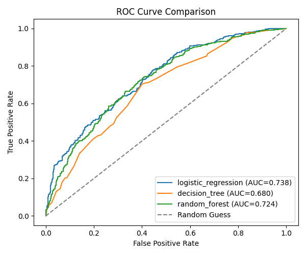

# 💳 Credit Scoring Model (Task 1 — Internship)


Predict individual **creditworthiness** using financial data, with Logistic
Regression, Decision Tree, and Random Forest classifiers, evaluated using
Precision, Recall, F1-Score, and ROC-AUC.

## 📌 Overview

This project implements a complete end-to-end machine learning pipeline that
predicts whether an individual is a good or bad credit risk based on their
financial history. It covers data generation, feature engineering, model
training, and multi-model evaluation — built as part of a B.Tech CSE
internship task.

## 📁 Project Structure

```
credit_scoring_project/
│
├── data/
│   ├── generate_data.py     # Creates the synthetic financial dataset
│   └── credit_data.csv      # Generated dataset (created after first run)
│
├── src/
│   ├── preprocessing.py     # Feature engineering, train/test split, scaling
│   ├── train_model.py       # Trains Logistic Regression, Decision Tree, Random Forest
│   └── evaluate.py          # Metrics, confusion matrices, ROC curves
│
├── models/                  # Saved trained models (.joblib) — created after run
├── outputs/                 # Saved plots + comparison table — created after run
│
├── main.py                  # Runs the FULL pipeline end-to-end
├── requirements.txt
└── README.md
```

## 🧠 What each feature means (Feature Engineering)

| Feature                     | Meaning                                             |
|------------------------------|------------------------------------------------------|
| income                       | Monthly income (INR)                                |
| age, employment_years        | Demographics/stability signals                      |
| existing_debts                | Total outstanding debt                              |
| debt_to_income_ratio          | Engineered: debts ÷ annual income                   |
| num_credit_accounts           | Number of open credit lines                          |
| credit_utilization            | % of available credit currently used                |
| late_payments_last_year       | Missed/late payment count                            |
| loan_amount_requested          | Amount of loan being applied for                     |
| credit_history_years           | Length of credit history                              |
| loan_to_income_ratio           | Engineered: loan amount ÷ annual income              |
| high_risk_flag                  | Engineered: late payments ≥2 AND utilization > 60%   |
| **creditworthy** (target)      | 1 = good credit risk, 0 = bad credit risk            |

> Note: Since real bank credit datasets are private/regulated, this project
> uses a **synthetic dataset** generated with realistic financial logic —
> exactly as your task description suggests ("Dataset could include: income,
> debts, payment history, etc.").

---

## 🚀 Step-by-Step: How to Run in VS Code

### Step 1 — Install Python
Make sure Python 3.9+ is installed. Check in VS Code terminal:
```bash
python --version
```
If not installed, download from https://www.python.org/downloads/ (tick
"Add Python to PATH" during install on Windows).

### Step 2 — Open the project folder in VS Code
- Open VS Code
- `File > Open Folder` → select the `credit_scoring_project` folder

### Step 3 — Install the Python extension (if not already)
- Go to Extensions (Ctrl+Shift+X) → search "Python" (by Microsoft) → Install

### Step 4 — Create a virtual environment (recommended)
Open the VS Code integrated terminal (`` Ctrl+` ``) and run:
```bash
python -m venv venv
```
Activate it:
- **Windows:** `venv\Scripts\activate`
- **Mac/Linux:** `source venv/bin/activate`

### Step 5 — Install dependencies
```bash
pip install -r requirements.txt
```

### Step 6 — (Optional) Generate the dataset separately
You can generate the dataset on its own first if you want to inspect it:
```bash
python data/generate_data.py
```
This creates `data/credit_data.csv`.

### Step 7 — Run the full pipeline
```bash
python main.py
```
This single command will:
1. Generate the dataset (if not already present)
2. Preprocess + engineer features + split + scale
3. Train all 3 models
4. Evaluate each with Precision, Recall, F1, ROC-AUC
5. Save confusion matrices + ROC curve comparison in `outputs/`
6. Save trained models in `models/`
7. Print a final comparison table and announce the best model

### Step 8 — Check your results
After running, look inside:
- `outputs/model_comparison.csv` → table comparing all models
- `outputs/confusion_matrix_*.png` → confusion matrix per model
- `outputs/roc_curve_comparison.png` → ROC curves of all 3 models overlaid
- `models/*.joblib` → your saved trained models (reusable later)

---

## 📈 Results

Model performance on the test set (synthetic data, 5000 samples):

| Model | Accuracy | Precision | Recall | F1-Score | ROC-AUC |
|---|---|---|---|---|---|
| Logistic Regression | 0.653 | 0.652 | 0.643 | 0.648 | **0.738** |
| Decision Tree | 0.651 | 0.633 | 0.704 | 0.667 | 0.680 |
| Random Forest | 0.657 | 0.660 | 0.637 | 0.648 | 0.724 |

🏆 **Best model by ROC-AUC: Logistic Regression**

ROC Curve comparison and confusion matrices for each model are saved in
`outputs/` after running `main.py`.



## 📊 Metrics explained (for your report/presentation)

- **Precision** — Of everyone predicted creditworthy, how many actually were?
- **Recall** — Of everyone who actually was creditworthy, how many did we catch?
- **F1-Score** — Harmonic mean of Precision & Recall (balance between the two).
- **ROC-AUC** — How well the model separates good vs bad credit risk overall
  (1.0 = perfect, 0.5 = random guessing).

